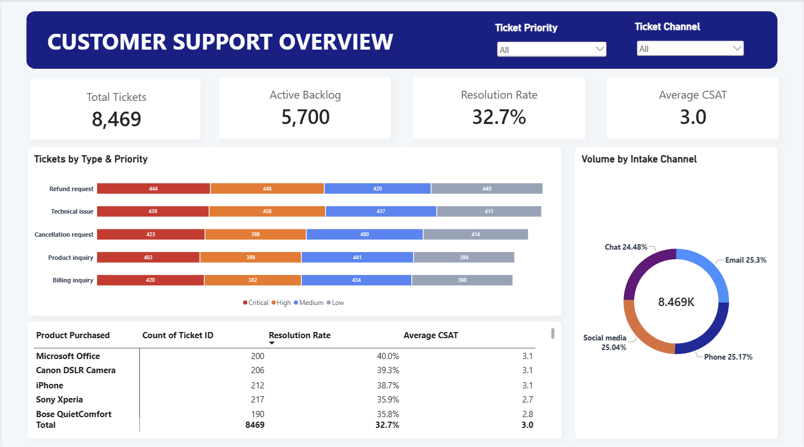
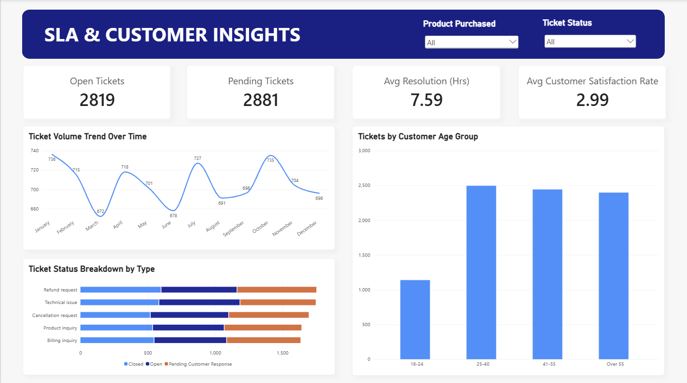

# Customer Support Operations & SLA Analytics Dashboard (Power BI)

An interactive, two-page **Microsoft Power BI** business intelligence solution designed to monitor customer support ticket volume, active backlog, SLA resolution times, and customer satisfaction (CSAT) across intake channels, product lines, and demographic segments[cite: 15, 16].

---

## Dashboard Preview

### 1. Executive Overview
High-level operational command center tracking overall ticket intake, backlog distribution, resolution efficiency, and product-level CSAT[cite: 15].



### 2. SLA & Customer Insights
Deep-dive operational view analyzing open vs. pending ticket queues, net resolution duration, monthly ticket seasonality, and customer age brackets[cite: 16].



---

## Key Metrics & Insights

* **Total Ticket Volume:** **8,469** tickets distributed evenly across four intake channels — Email (25.30%), Phone (25.17%), Social Media (25.04%), and Chat (24.48%)[cite: 15].
* **Backlog & Resolution Rate:** **5,700** active backlog tickets (**2,819** Open[cite: 13] and **2,881** Pending[cite: 13]) against a **32.7%** resolution rate[cite: 15].
* **Customer Satisfaction (CSAT):** Overall average rating of **3.0 / 5.0**, with software and flagship hardware categories (Microsoft Office, Canon DSLR Camera, iPhone) achieving the highest resolution rates (~38.7%–40.0%)[cite: 15].
* **SLA Resolution Speed:** Average resolution duration of **7.59 hours** across resolved tickets after filtering out timestamp anomalies[cite: 13].

---

## Data Modeling & Engineering Highlights

* **Power Query (M) ETL & Feature Engineering:**
  * Standardized data types (`Decimal`, `Date/Time`, `Text`) and handled `null` resolution entries[cite: 14].
  * Engineered a custom **`Priority Order`** conditional column (`Critical` $\rightarrow$ `High` $\rightarrow$ `Medium` $\rightarrow$ `Low`) to enforce logical severity sorting without triggering DAX circular dependency errors[cite: 11, 15].
  * Created clean demographic brackets (**`Age Groups`**: `18-24`, `25-40`, `41-55`, `Over 55`)[cite: 14, 16] sorted chronologically via custom rank mapping.
* **DAX Measures:**
  * Built dynamic KPI calculations for `Total Tickets`, `Active Backlog`, `Open Tickets`, `Pending Tickets`, `Resolution Rate`, and `Average CSAT`[cite: 13, 15].
  * Engineered a filtered **`Avg Resolution (Hrs)`** measure to exclude negative duration anomalies caused by source timestamp discrepancies:
    ```dax
    Avg Resolution (Hrs) = 
    CALCULATE(
        AVERAGE('customer_support_tickets'[Resolution Duration (Hours)]),
        'customer_support_tickets'[Resolution Duration (Hours)] > 0
    )
    ```
* **UX & Visual Hierarchy:**
  * Designed with a light-mode, high-contrast executive layout featuring persistent header banners, interactive dropdown slicers (`Ticket Priority`, `Ticket Channel`, `Product Purchased`, `Ticket Status`)[cite: 15, 16], severity-encoded color palettes, and decluttered axes[cite: 15].

---

## How to View This Project

## How to View This Project

1. **Quick Preview (No Software Required):** Open [`Customer Support Overview.pdf`](report/Customer%20Support%20Overview.pdf) directly in your browser to view both report pages.
2. **Dataset:** Raw operational dataset available at [`report/customer_support_tickets.csv`](report/customer_support_tickets.csv)[cite: 18].
3. **Interactive Exploration:** Download [`customer_Support_overview.pbix`](report/customer_Support_overview.pbix) and open it in **Microsoft Power BI Desktop** to interact with cross-filtering, slicers, and the underlying Power Query / DAX model[cite: 18].

---

## Tech Stack
* **BI & Visualization:** Microsoft Power BI Desktop
* **ETL & Data Transformation:** Power Query (M)
* **Analytics & Calculations:** DAX (Data Analysis Expressions)
